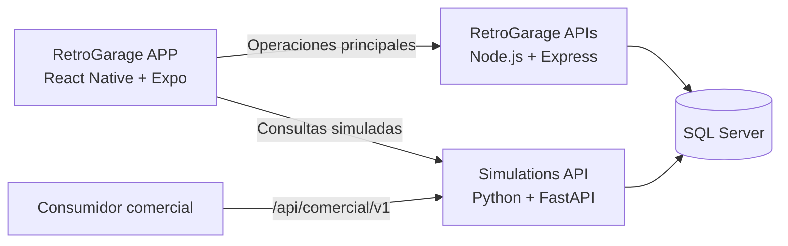

# RetroGarage Simulations API

API REST complementaria del ecosistema RetroGarage. Simula consultas a entidades y socios externos —identificación de clientes, proveedores de repuestos, aseguradoras, grúas y vehículos de alquiler— y expone un conjunto comercial para consultar servicios, productos, disponibilidad de agenda y cotizaciones.

El proyecto fue desarrollado individualmente como parte de un trabajo universitario y utiliza datos de demostración almacenados en SQL Server.

> **Estado:** prototipo académico funcional. Las respuestas representan servicios simulados; no existe conexión con el TSE, aseguradoras, proveedores ni otras entidades reales.


## Funcionalidades principales

- Consulta simulada de personas por identificación.
- Búsqueda de repuestos por texto o código entre proveedores asociados.
- Consulta de pólizas de seguros por placa.
- Búsqueda de grúas disponibles, con filtro opcional por provincia.
- Consulta de vehículos de alquiler, con filtro opcional por categoría.
- Catálogo comercial de servicios y productos disponibles.
- Cálculo de espacios de agenda según fecha y capacidad por hora.
- Generación de cotizaciones informativas con productos, servicios e IVA.
- Validación de entradas y respuestas mediante modelos de Pydantic.
- Documentación interactiva automática con Swagger UI y ReDoc.
- Endpoints de salud y disponibilidad para despliegues administrados.
- Configuración de CORS, encabezados de seguridad y consultas SQL parametrizadas.

## Tecnologías

- **Lenguaje:** Python 3.12.
- **API:** FastAPI y Uvicorn.
- **Validación:** Pydantic.
- **Base de datos:** SQL Server mediante `pyodbc` y ODBC Driver 18.
- **Configuración:** `python-dotenv` y variables de entorno.
- **Pruebas:** `unittest` para la configuración de entorno.
- **Despliegue:** Docker y Render Blueprint.

## Arquitectura



## Requisitos

- Python 3.12 o una versión compatible con las dependencias fijadas.
- SQL Server accesible por TCP.
- Microsoft ODBC Driver 18 for SQL Server.
- Esquema y datos de demostración del repositorio [RetroGarageAPIs](https://github.com/sebas1-1/RetroGarageAPIs).
- Git y `pip`.

## Instalación local

Clona el repositorio y crea un entorno virtual:

```powershell
git clone https://github.com/sebas1-1/SimulacionesAPIs.git
cd SimulacionesAPIs
python -m venv .venv
.\.venv\Scripts\Activate.ps1
python -m pip install --upgrade pip
pip install -r requirements.txt
```

Crea la configuración local a partir del archivo de ejemplo:

```powershell
Copy-Item .env.example .env
```

Completa como mínimo la conexión a SQL Server:

```dotenv
ENVIRONMENT=development
CORS_ORIGINS=http://localhost:8081,http://127.0.0.1:8081

DB_SERVER=localhost
DB_DATABASE=RetroGarage
DB_USER=TU_USUARIO_SQL
DB_PASSWORD=TU_CONTRASENA_SQL
DB_PORT=1433
DB_DRIVER=ODBC Driver 18 for SQL Server
DB_ENCRYPT=no
DB_TRUST_SERVER_CERTIFICATE=yes
DB_CONNECTION_TIMEOUT_SECONDS=10
```

Inicia el servidor de desarrollo:

```powershell
uvicorn main:app --reload --host 0.0.0.0 --port 8000
```

La documentación estará disponible en:

- Swagger UI: `http://localhost:8000/docs`
- ReDoc: `http://localhost:8000/redoc`
- Estado del servicio: `http://localhost:8000/health`
- Verificación de base de datos: `http://localhost:8000/ready`

## Variables de entorno

| Variable | Descripción |
| --- | --- |
| `ENVIRONMENT` | Entorno de ejecución: `development` o `production`. |
| `CORS_ORIGINS` | Orígenes permitidos, separados por comas. Es obligatorio en producción. |
| `DB_SERVER` | Servidor o nombre DNS de SQL Server. |
| `DB_DATABASE` | Base de datos de RetroGarage. |
| `DB_USER` | Usuario de la base de datos. |
| `DB_PASSWORD` | Contraseña de la base de datos. |
| `DB_PORT` | Puerto de SQL Server; utiliza `1433` por defecto. |
| `DB_DRIVER` | Nombre del controlador ODBC instalado. |
| `DB_ENCRYPT` | Activa o desactiva el cifrado de la conexión. |
| `DB_TRUST_SERVER_CERTIFICATE` | Define si se confía en el certificado del servidor. |
| `DB_CONNECTION_TIMEOUT_SECONDS` | Tiempo máximo para establecer la conexión. |

No publiques el archivo `.env` ni credenciales reales. El repositorio solo versiona `.env.example`.

## Endpoints de simulación

| Método | Ruta | Descripción |
| --- | --- | --- |
| `GET` | `/clientes/{identificacion}` | Consulta una persona simulada por identificación. |
| `GET` | `/socios/proveedores/repuestos?buscar={texto}` | Busca repuestos activos entre proveedores. |
| `GET` | `/socios/proveedores/repuestos/{codigo}` | Compara repuestos disponibles por código. |
| `GET` | `/socios/aseguradoras/polizas/{placa}` | Consulta una póliza simulada por placa. |
| `GET` | `/socios/gruas/disponibles?provincia={provincia}` | Lista grúas disponibles. |
| `GET` | `/socios/alquileres/disponibles?categoria={categoria}` | Lista vehículos de alquiler disponibles. |

## API comercial

Base: `/api/comercial/v1`

| Método | Ruta | Descripción |
| --- | --- | --- |
| `GET` | `/servicios?buscar={texto}` | Consulta el catálogo público de servicios. |
| `GET` | `/productos?buscar={texto}` | Consulta productos y disponibilidad de inventario. |
| `GET` | `/agenda/disponibilidad?fecha=AAAA-MM-DD` | Calcula espacios disponibles para una fecha. |
| `POST` | `/cotizaciones` | Genera una cotización informativa sin almacenarla. |

Ejemplo de cotización:

```json
{
  "servicios": [1, 3],
  "productos": [
    {
      "id_producto": 2,
      "cantidad": 2
    }
  ]
}
```

La especificación comercial ampliada se encuentra en [`API_COMERCIAL.md`](API_COMERCIAL.md).

## Pruebas y comprobaciones

Con el entorno virtual activo y un archivo `.env` válido:

```powershell
python -m unittest discover -s tests -v
```

Para comprobar manualmente la conexión a SQL Server:

```powershell
python test_db.py
```

También puedes validar todos los endpoints desde `/docs` sin configurar encabezados especiales.

## Estructura del proyecto

```text
SimulacionesAPIs/
├── routers/              # Rutas de la API comercial
├── tests/                # Pruebas de configuración
├── main.py               # Aplicación y rutas de simulación
├── config.py             # Lectura y validación del entorno
├── database.py           # Conexión ODBC con SQL Server
├── models.py             # Modelos de las simulaciones
├── public_models.py      # Modelos de la API comercial
├── API_COMERCIAL.md      # Especificación comercial ampliada
├── Dockerfile            # Imagen de producción sin usuario root
└── render.yaml           # Blueprint de despliegue en Render
```

## Seguridad y limitaciones

- Las consultas utilizan parámetros en lugar de concatenar valores proporcionados por el usuario.
- En producción, `CORS_ORIGINS` debe contener una lista explícita y no permite `*`.
- El contenedor se ejecuta con un usuario sin privilegios.
- La API no implementa autenticación; debe utilizar únicamente datos ficticios o de demostración.
- Los servicios externos son simulaciones académicas y no deben presentarse como integraciones oficiales.

## Despliegue

El repositorio incluye un [`Dockerfile`](Dockerfile) con Python 3.12, ODBC Driver 18 y ejecución mediante Uvicorn, además de un [`render.yaml`](render.yaml) preparado para Render. Las credenciales de SQL Server se configuran como variables secretas en la plataforma y `/ready` funciona como verificación de disponibilidad.

## Repositorios relacionados

- [RetroGarageAPP](https://github.com/sebas1-1/RetroGarageAPP): aplicación móvil y web en React Native, Expo y TypeScript.
- [RetroGarageAPIs](https://github.com/sebas1-1/RetroGarageAPIs): API principal en Node.js, Express y SQL Server.

## Autor

**Pedro Sebastián Navarro Mariño**

- [GitHub](https://github.com/sebas1-1)
- [LinkedIn](https://www.linkedin.com/in/pedro-sebastian-navarro)
